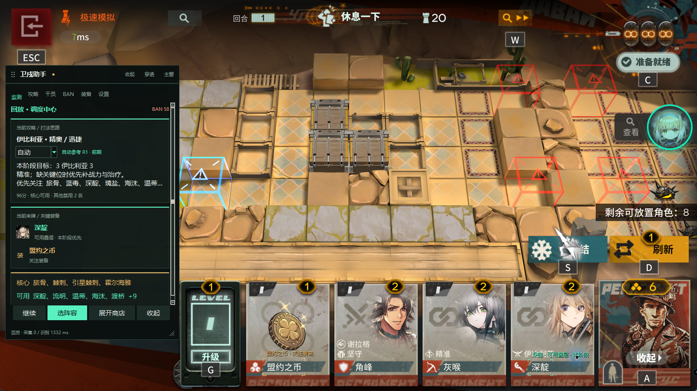

# Arknights Stronghold Assistant

A Windows companion for **Arknights Stronghold Protocol** (明日方舟·卫戍协议). It reads the game screen locally, recommends lineups based on bans, and highlights relevant operators and equipment in a draggable overlay.

[Download for Windows](https://github.com/Fuppppping/stronghold-assistant/releases/latest) · [简体中文](README.md) · [Report an issue](https://github.com/Fuppppping/stronghold-assistant/issues)

**The current recognizer supports the Simplified Chinese game UI.** This is a community tool, unaffiliated with the game publisher, MAA, or MaaFramework.

## Features

- Infer banned operators from recognized pacts, then supplement the result by reading the scrollable ban list. Uncertain entries remain unconfirmed.
- Compare whole lineups, including core operators, stacking roles, missing cards and explicit alternatives. Fit scores are not win probabilities.
- Track a selected guide and highlight relevant operators, strategy choices and equipment. Equipment alerts can also be enabled or muted manually.
- Use a movable, resizable, always-on-top panel with six pages. Lock the content to pass clicks through to the game; the header remains interactive so you can unlock it.
- Record visible teammate holdings and estimate shared-pool availability. This is not an exact server-side card counter.
- Reset match records for a new run while keeping preferences. Check and download updates in the background, then choose when to install.

## Get started

1. Download the latest `windows-x64.zip` from [Releases](https://github.com/Fuppppping/stronghold-assistant/releases/latest), extract the entire archive, and run `StrongholdAssistant.exe`. Python and model setup are not required for this package.
2. Open the Simplified Chinese Arknights PC client, or a supported emulator. The assistant looks for the game window; you can also select it manually.
3. Enter the match information screen to read pacts and bans. Select a guide under **阵容攻略** to start tracking it.
4. Click **悬浮窗模式** in the main window footer for the floating panel. Drag its header to move it, drag the lower-right corner to resize it, and use **穿透 / 解锁** to toggle click-through.

Ordinary recognition does not require administrator access. The explicit PC shop open/close buttons do. The assistant does not play complete matches automatically.

## Settings and updates

Font size, opacity, panel placement and equipment preferences are configurable. Settings, imported guides and logs are stored in `%LOCALAPPDATA%\StrongholdAssistant`.

The floating panel follows the game window and can snap to its edges. Switching to another application automatically collapses the content, leaving an interactive header; returning to the game or using the assistant restores it. Manual collapse is preserved. These behaviors can be disabled in floating-panel settings.

Adaptive sampling reduces background and unchanged-screen work while preserving priority for pact and strategy selection. Returning to the game triggers a fresh capture. The option can be disabled; failed captures still use bounded retry backoff. Sampling intervals are separate from OCR processing time.

Version 0.3.11 reduces repeated high-resolution resizing and redundant shop-button OCR. Cheap foreground repeats keep a 250 ms sampling target; more expensive repeats can slow to 500 ms. Local sample benchmarks, artificial-probe limits and reproducible comparisons are documented in [PERFORMANCE.md](PERFORMANCE.md); they are not end-to-end latency guarantees.

Version 0.3.3 and later support in-app updates. Earlier versions require one manual upgrade. Downloads are verified before installation; the updater backs up existing files and attempts rollback if the new application fails to start.

Version 0.3.7 supplements system trust with certifi's Mozilla CA bundle for Windows systems with incomplete certificate stores. Certificate and hostname verification remain enabled. If an older version reports a certificate error, download the latest package manually once.

## Guides, development and attribution

You can explicitly designate one observed panel as your roster. Only its fresh visible holdings affect lineup ranking; teammate panels and shop offers are not treated as yours. Ownership adds at most 20 ranking points and cannot bypass unavailable key roles. Pivot comparisons show reusable cards and roles not yet recorded, without switching guides automatically. The binding follows panel position and resets for a new match. Reassign it if panel order changes. Each record expires for scoring after 30 seconds; other fresh records remain eligible.

Automatic observations and manual corrections have independent timestamps. Editing one card does not refresh the rest of the panel, and reading new frames does not renew an old correction. Corrections stop overriding after 30 seconds and can be undone. The record table shows source and age; stale history is retained for review and blocks numeric pool estimates. Sessions from older versions require fresh panel observations because they lack reliable per-correction timestamps.

Stage advice follows confirmed round numbers and explicit guide ranges. Eleven built-in guides provide those ranges; the other two require manual stage selection. Unknown or stale rounds fall back to the overall plan. Manual choices last for the current match and reset for a new run. Current-stage cards receive extra emphasis without hiding global cores or counting shop offers as owned cards.

There are currently **13 built-in guides and branches**. Guide sources are retained in the application. See the [Chinese usage guide](README.md), [guide JSON format](攻略JSON格式.md), [example guide](guide.example.json), and [performance notes](PERFORMANCE.md) for details and limitations.

Source setup, build instructions and the component table are in [README.md](README.md#从源码运行). This project references MAA's recognition and PC-control workflow and uses MaaFramework for explicit single-step PC input; it does not bundle the MAA application.

Original application code and project documentation use the [MIT License](LICENSE). Game assets, PRTS-derived text, third-party models, components and guide material retain their own rights and licenses. Read [THIRD_PARTY_NOTICES.md](THIRD_PARTY_NOTICES.md) and [DEPENDENCIES.json](DEPENDENCIES.json), and preserve the notices and license files when redistributing the package.
