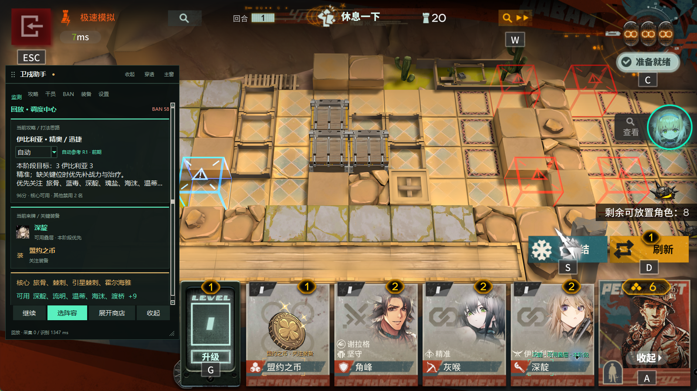
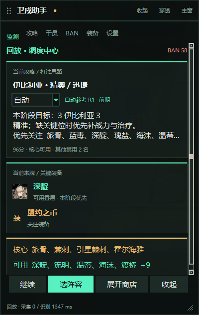
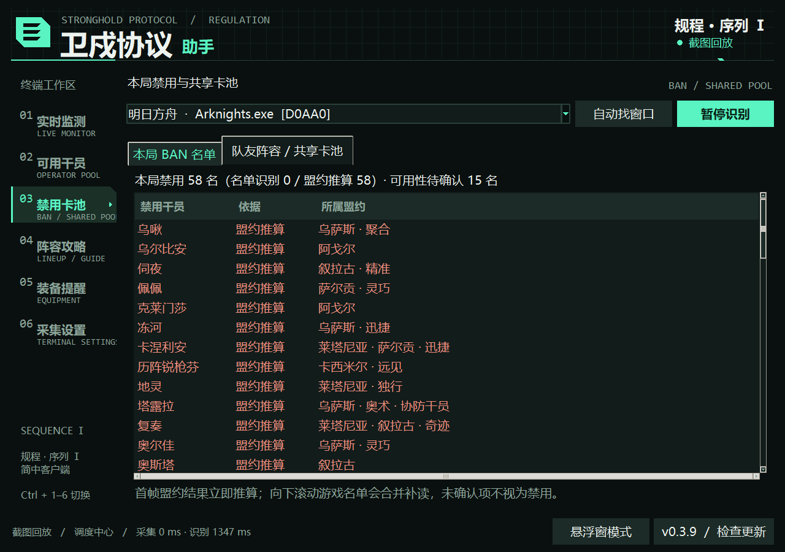
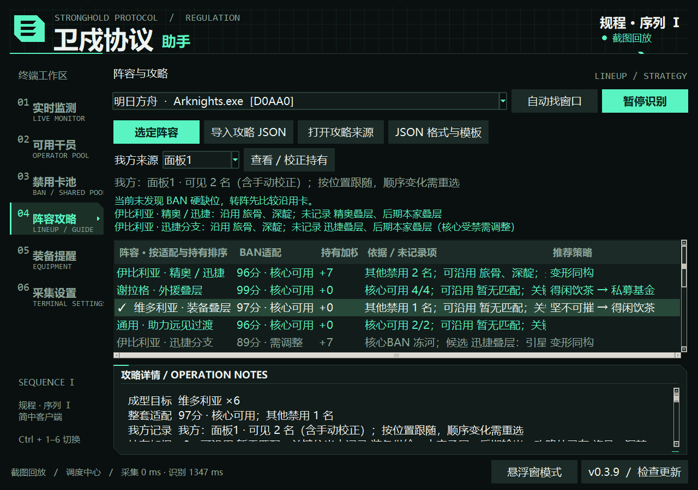

# 明日方舟卫戍协议助手 · Arknights Stronghold Assistant

**开局看 BAN，选好阵容，来牌时提醒。** 用于《明日方舟 Arknights》卫戍协议（Stronghold Protocol）的 Windows 游戏助手，支持本地画面识别、整套阵容推荐和可拖动的穿透悬浮窗。

[](https://github.com/Fuppppping/stronghold-assistant/releases/latest)


**[下载 Windows 版](https://github.com/Fuppppping/stronghold-assistant/releases/latest)** · [快速上手](#快速上手) · [悬浮窗模式](#悬浮窗模式) · [常见问题](#常见问题) · [攻略 JSON](攻略JSON格式.md) · [反馈问题](https://github.com/Fuppppping/stronghold-assistant/issues)

简体中文 | [English](https://github.com/Fuppppping/stronghold-assistant/blob/main/README.en.md)

A Windows companion for **Arknights Stronghold Protocol**: ban detection, lineup recommendations, operator and equipment alerts, and a draggable click-through overlay. The current recognizer supports the **Simplified Chinese game UI**.



## 主要功能

| 你在做什么 | 助手能帮什么 |
| --- | --- |
| 开局选盟约 | 读到有效盟约后推算禁用干员，滚动 BAN 名单继续补读，并标明判断依据 |
| 决定玩哪套 | 按整套 BAN 检查核心与功能位；指定我方来源后，再参考已记录持有，并列出可沿用卡与转阵备选 |
| 刷商店、选策略 | 选定攻略后，标出相关干员、推荐策略和关键装备；装备也能自行勾选或屏蔽 |
| 边打边看攻略 | 用可拖动、可缩放的置顶悬浮窗看打法与叠层；内容区可穿透，顶栏始终可解锁 |
| 看当前该拿什么 | 确认回合后，按攻略明确的回合区间显示本阶段思路与优先来牌；也可手动指定阶段 |
| 看队友阵容 | 按面板记录可见持有量，可手动校正；剩余卡池只提供估算 |
| 重开或更新程序 | 新局重置本局记录；个人偏好保留，程序更新先下载，再由你决定何时安装 |

画面识别在本机运行。当前支持简中官方 PC 客户端和可正常抓屏的模拟器；**它提供建议和提醒，暂不支持完整自动对局**。阵容适配分不是胜率，替代卡也不保证等强。

<details>
<summary>更多演示：悬浮窗近景、BAN 名单与阵容推荐</summary>

**局中看思路与来牌。** 金色强调核心和关键装备，青绿标记可用叠层。小窗有监测、攻略、干员、BAN、装备和设置六页。



**开局先看禁用依据。** 名单区分「盟约推算」与「名单识别」，待确认项不会强行算成禁用。



**阵容推荐看整套卡与持有记录。** 下图含手动录入示例，展示持有加权、可沿用卡和转阵比较；不代表商店里的牌已经买到。



以上均为离线回放演示，不代表当前对局。游戏画面归鹰角网络及相关权利人所有。

</details>

## 下载安装

当前程序版本 **0.3.9**。在 [Releases](https://github.com/Fuppppping/stronghold-assistant/releases/latest) 下载 `StrongholdAssistant-v版本号-windows-x64.zip`，**完整解压**后运行 `StrongholdAssistant.exe`。Windows 发布包已经带好 OCR 模型，不用安装 Python。

0.3.3 及更新版本可以在底栏「检查更新」升级；0.3.2 及更早版本需要先手动下载一次。新用户直接下载最新的 Windows 包即可。

## 快速上手

1. 完整解压下载的压缩包，运行 `StrongholdAssistant.exe`，再打开游戏。助手会寻找客户端；有多个窗口时可以手动选。
2. 进入卫戍协议的「确认本局信息」，等助手读出盟约和 BAN。有误的盟约可以双击校正。
3. 在「阵容攻略」选定想玩的阵容。之后的干员、策略和装备提示会跟着这套攻略走。
4. 装备不一定要跟攻略：在「装备提醒」里自行勾选或屏蔽。屏蔽的装备不会再提醒。
5. 重开新局后，本局 BAN、已见干员和队友快照会自动清空；选定攻略和个人偏好会保留。

左侧切换页面，也可以用 `Ctrl + 1–6`。普通识别不需要管理员权限；「展开商店 / 收起商店」这两个 PC 单步按钮需要以管理员身份运行助手。

## 悬浮窗模式

- **移动、缩放**：拖动顶栏移动，拖右下角缩放。位置、尺寸、不透明度和模式会记住。
- **收起**：点顶栏「收起」只留一条标题栏，再点「展开」恢复。
- **穿透**：点「穿透」后，内容区的点击会直接落到游戏；顶栏仍能拖动、解锁和返回主窗口。
- **返回主窗**：点顶栏「主窗」。导入攻略、手动校正和高级采集设置也会回到主窗口处理。
- **调外观**：在悬浮窗「设置」里调整字号与不透明度，也能恢复默认位置。
- **跟随和吸附**：默认跟随游戏窗口移动，拖近边缘后松手会吸附。贴近右侧或底部时，游戏窗口缩放也会保留贴边位置；这些选项可以在小窗设置里关闭。

切成悬浮窗后，识别继续运行，阵容和本局记录共用同一份数据。游戏卡片附近的小提示可以单独开关；固定在左上的文字思路会收进面板，避免重复显示。默认切出游戏时自动收起内容，只留可操作的顶栏；切回游戏或点击顶栏使用助手时恢复。手动收起会保留，游戏未找到时也不会藏住整个面板。关闭「切出游戏时收起内容」可让整窗常驻。

在助手内按 `Ctrl + Shift + F` 也能切换模式。分辨率变化或断开副屏后，会把面板移回可见区域。

## 字号与外观

打开「采集设置」，拖动「浮层字号」即可，范围是 **80%–200%**，调整后即时生效并记住。默认是 **135%**；「恢复默认」可以一键重置。

普通模式仍使用左上透明文字；悬浮窗模式把这些信息放进面板。可以在设置中关闭游戏卡片附近的小提示。

## 程序更新

启动后会在后台检查新版本，之后每 6 小时检查一次。发现更新只在底栏提示，不会在对局中替你安装。自动检查可以在设置中关闭。

点击底栏或「采集设置 → 程序更新」，先下载，等方便的时候再点「安装并重启」。下载会校验完整性，安装前会备份；新版启动失败时会尝试恢复旧版。设置和导入的攻略都会保留。

**0.3.2 及更早版本没有更新入口，需要手动下载新版一次。0.3.3 起可以在程序内更新。**

如果 GitHub 连不上，稍后重试或从发布页手动下载。程序所在文件夹需要可写；更新过程不会主动请求管理员权限。同一游戏窗口还开着时，更新重启可恢复 15 分钟内的本局记录。

## 攻略与自定义

目前内置 **13 条阵容和运营分支**。每条保留来源，可以点「打开攻略来源」看原视频。主窗口和悬浮窗可选择「自动」或手动指定阶段；自动模式在连续两帧确认回合后，按攻略中明确的回合区间切换，显示本阶段思路和优先关注干员。它是攻略节奏参考，不是必须照做的购买指令。

内置11条攻略有明确的回合区间；另外2条只写了本数或大致阶段，需要手动选择。回合显示“??”、识别不足或30秒未更新时，不猜阶段，退回整套思路。手动选择本局有效，不被后续识别覆盖，重开恢复自动。当前阶段的来牌会优先展示，其他阶段的核心与常驻叠层仍保留；商店来牌不会计作已拥有。

有自己的打法，可以在「阵容攻略 → JSON 格式与模板」另存模板，改完再导入。先看 [攻略示例](guide.example.json)；完整字段写在 [攻略 JSON 格式](攻略JSON格式.md) 里。`plan` 是常驻思路，`stacking` 用来区分核心和可用叠层，`requirements` 用来写关键位和替代候选。

## 继续还是转阵

在「阵容攻略」或小窗「攻略」页，将你确认属于自己的那行设为「我方来源」。也可以在「队友阵容 / 共享卡池」选好面板后点「设为我方」。**没有看到自己的面板，或不确定是哪行，就保持「未指定」。** 助手目前按面板位置跟随，不会自动认出玩家身份；顺序改变时需要重新指定。

指定后，排序会同时参考整套 BAN 和我方可见持有，分别显示基础适配分与持有加权。当前阵容之外，会列出最多两套有沿用基础的备选，说明能沿用哪些卡、哪些关键位尚未记录。只有一张通用打工卡时，不会因此建议转阵；是否切换仍由你选定攻略。

「尚未记录」不等于没有：备战区和漏识别都可能未计入。「核心可用」表示卡池允许，不表示已经买到。与 BAN 冲突的持有会标为待核对，不会据此解除禁用。转阵比较暂不计算经济和装备，攻略外的已有卡也不等于必须卖掉。

来源未指定、尚无记录或超过30秒未更新时，排序退回基础适配。重新读取我方面板即可恢复；重开或清除此面板会解除绑定。指定来源只是复用同一份记录，不会在共享卡池里重复扣卡。

<details>
<summary>持有加权怎么算</summary>

按干员名字去重：攻略核心和核心叠层每名加6，上限16；其他攻略干员每名加1，上限4，总计最多20。重复卡与精锐星级不重复加分。关键位受禁仍先降级；基础分继续参考整套 BAN、可用池和少量当前来牌因素。加权不是胜率，也不是养成完成度。

</details>

## 队友阵容和剩余卡池

打开游戏里的队友总览，助手会按从上到下的「面板1–4」记录可见干员。重复看到同一面板时会覆盖旧快照，不会把商店里没买的卡算进去。星级看不清时只记占用下限，可以在「禁用卡池 → 队友阵容 / 共享卡池」手动校正。

**余量是估算，不能当精确记牌器。** 当前版本的总池量还没可靠核实，默认只显示已见占用；你设置总池量后，才会给出余量范围。暂按普通1份、精锐3份计算，星极精锐按2份。没看到的备战区、赠送牌和记录时差都会影响结果；30秒没更新会提示过期。队友行顺序变了，需要清掉旧行再读。

机制参考：[共享卡池实测](https://www.bilibili.com/video/BV1JWy3BkEpt/)、[本期官方演示](https://www.bilibili.com/video/BV18RHN64EZV?p=2)。

## 常见问题

- 抓不到画面：把游戏切到前台，试试窗口化或无边框模式。模拟器也可以在采集设置里改用 ADB。
- BAN 少了：向下滚动游戏名单，让助手继续读；无法确认的内容会保留为待确认。
- 换了皮肤后漏识别：当前头像模板覆盖固定池143名干员，自选干员和皮肤可能漏读。可以导入截图回放检查。
- 提醒慢：主窗口底部会分别显示采集和识别耗时。已做区域复用和缓存，具体测试范围见 [性能说明](PERFORMANCE.md)。
- 检查更新提示证书错误：0.3.7 已补充可信证书支持。旧版遇到该问题时，从发布页手动下载一次新版。

默认开启节能识别：后台降低采样，切回游戏时优先采集，开局盟约和策略选择页保留高频采样。需要固定高频时，可在采集设置或悬浮窗设置关闭该选项。采样间隔与一次识别本身的耗时是两回事。

这版主要按简中、横屏和常见终端主题校准。它会读画面、给建议，不能自动打完整对局；PC 单步按钮也只会展开或收起商店。

## 设置与日志

个人设置、导入攻略和日志都在 `%LOCALAPPDATA%\StrongholdAssistant`。更新缓存和备份放在其中的 `updates` 文件夹；确认程序正常并关闭所有助手后，可以清理旧任务来腾空间。源码运行可用 `STRONGHOLD_STATE` 改位置。

## 问题反馈与参与

遇到识别错误或界面问题，可以先看上面的常见问题，再到 [Issues](https://github.com/Fuppppping/stronghold-assistant/issues) 反馈。带上程序版本、PC 客户端或模拟器类型、分辨率，以及出错场景和复现步骤，会更容易定位。

欢迎补充可复现的识别问题、修正攻略和提交改进。攻略请保留原作者与来源链接；模型、素材和第三方代码请遵守各自许可。版本变动见 [更新记录](CHANGELOG.md)，识别耗时和测试范围见 [性能说明](PERFORMANCE.md)。

## 从源码运行

```powershell
py -3.12 -m venv .venv
.\.venv\Scripts\python.exe -m pip install -r requirements.txt
.\.venv\Scripts\python.exe main.py
```

离线识别和规则测试：

```powershell
.\.venv\Scripts\python.exe -X utf8 main.py --inspect screenshot.png --output result.json
.\.venv\Scripts\python.exe -m unittest discover -s tests
```

打包前安装 `pyinstaller==6.22.3`，然后执行 `build.ps1`。源码仓库不包含 OCR 权重，首次运行可能需要下载模型；Windows 发布包已经带好模型。修改第三方依赖后，用 `tools/collect_notices.py` 更新声明，发布时保留 `licenses` 文件夹。

<details>
<summary>维护者：怎样发布程序内更新</summary>

先改 `stronghold/__init__.py` 的版本号，打包最终的 Windows ZIP，并附上 `SOURCE_PROVENANCE.json`。然后生成更新清单：

```powershell
python tools/make_update_manifest.py 0.3.9 StrongholdAssistant-v0.3.9-windows-x64.zip --notes release-notes.md --output update.json
```

把 ZIP 和 `update.json` 上传到对应的 `v0.3.9` 正式 Release，再设为最新版本。清单中的版本、大小、SHA-256 和包内来源信息要一致；不要上传后再替换包。更新客户端只接受已管理的程序、文档、演示图和许可路径，新增文件前要考虑旧客户端的兼容性。预发布版不会走这个更新通道。

更新通过本仓库的 HTTPS Release 清单分发。SHA-256 用来检查下载损坏，当前没有独立代码签名；源码运行可以检查和下载，自动安装仅支持打包程序。

</details>

## 参考代码与组件

参考了 MAA 的截图、ROI、模板识别和 PC 控制思路，也用到它的简中干员名称字典。实际单步输入用的是 MaaFramework。界面、本局状态、攻略整合和提醒逻辑在本仓库实现，没有集成 MAA 主程序。

| 项目 / 组件 | 用途 | 来源 |
| --- | --- | --- |
| MAA | 设计参考、PC 方案与干员名称字典；上游 AGPL-3.0 | [MAA 源码](https://github.com/MaaAssistantArknights/MaaAssistantArknights)、[battle_data.json](https://github.com/MaaAssistantArknights/MaaAssistantArknights/blob/dev-v2/resource/battle_data.json)、[PC 参考讨论](https://github.com/MaaAssistantArknights/MaaAssistantArknights/pull/18256) |
| MaaFramework / MaaFw 5.15.0 | Win32 单步控制与截图接口；LGPL-3.0 | [固定版本源码](https://github.com/MaaXYZ/MaaFramework/tree/v5.15.0)、[Python 示例](https://github.com/MaaXYZ/MaaFramework/blob/v5.15.0/sample/python/demo1.py) |
| RapidOCR 3.10.0 | 本地 OCR；Apache-2.0 | [RapidAI/RapidOCR](https://github.com/RapidAI/RapidOCR) |
| PaddleOCR PP-OCRv6 | 文本检测、识别模型，RapidOCR 提供 ONNX 封装；Apache-2.0 | [PaddlePaddle/PaddleOCR](https://github.com/PaddlePaddle/PaddleOCR) |
| ONNX Runtime 1.31.1 | CPU 推理；MIT | [microsoft/onnxruntime](https://github.com/microsoft/onnxruntime) |
| OpenCV Headless 5.0.0.93 | 图像处理和模板匹配；Apache-2.0 | [OpenCV Python](https://github.com/opencv/opencv-python) |
| NumPy 2.5.4 / Pillow 13.0.0 | 数组运算、抓屏、图像转换；BSD 系 / MIT-CMU 等 | [NumPy](https://github.com/numpy/numpy)、[Pillow](https://github.com/python-pillow/Pillow) |
| Python 3.12 / tkinter / ctypes | 桌面 UI、窗口浮层、Windows 系统接口 | [CPython](https://github.com/python/cpython)、[Tcl/Tk](https://www.tcl.tk/)、[Win32 API](https://learn.microsoft.com/windows/win32/api/) |
| PyInstaller 6.22.3 | Windows 打包；GPL 含 bootloader exception | [PyInstaller](https://github.com/pyinstaller/pyinstaller) |
| certifi 2026.10.23 | 更新连接的 Mozilla 根证书包；MPL-2.0 | [certifi/python-certifi](https://github.com/certifi/python-certifi) |
| PRTS / SquadPool | 本期干员、盟约、策略、装备及阵容资料；图标与头像来自游戏 | [PRTS 图鉴](https://prts.wiki/w/卫戍协议·规程/PRTS盟约记录)、[SquadPool](https://squad-pool.com/arknights-pacts) |

完整的组件、模型、素材来源和许可证见 [第三方说明](THIRD_PARTY_NOTICES.md) 与 [依赖清单](DEPENDENCIES.json)。攻略作者和原链接保留在各条攻略的 `sources` 中；演示图来自本项目的离线回放，游戏画面归鹰角网络及相关权利人所有。

原创代码和文档采用 [MIT](LICENSE)。PRTS 衍生文字保留 CC BY-NC-SA 3.0；第三方模型、组件、游戏素材和攻略各按原许可处理，不会因为放进这个仓库就变成 MIT。转发体验包时，请保留来源说明和许可证目录。

这是玩家工具，与鹰角、MAA、MaaFramework 及攻略作者没有隶属关系。版本改动见 [更新记录](CHANGELOG.md)。
